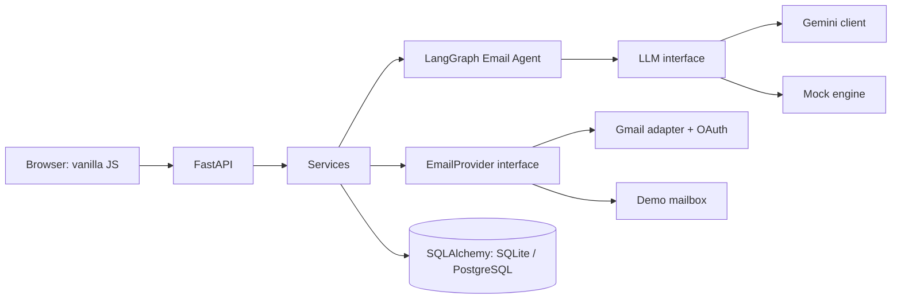
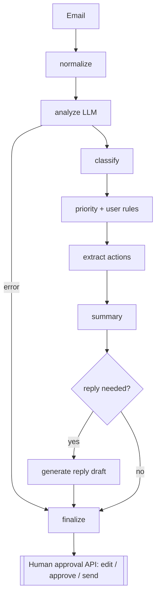

# Smart Email Agent

An **agentic AI email manager**: it reads your inbox, classifies and prioritises every email, extracts actions, deadlines and meetings, drafts replies, and **never sends anything without your explicit approval**.

> **Problem:** people receive dozens of emails a day, miss the important ones, forget deadlines and spend time writing routine replies.

Works out of the box in **Demo Mode** (mock mailbox + offline heuristic engine, no keys needed). Add a Gemini API key for real AI analysis, and Google OAuth credentials for live Gmail.

## Features
- LangGraph workflow: normalize → analyze → classify → priority → actions → summary → decide → (draft reply) → finalize
- Structured, schema-validated LLM output (Pydantic). Confidence is **never faked**: if the model gives none, it is `null`
- Priority rules you control (e.g. *Job → High*), applied by the agent
- Human-in-the-loop: Draft → Edit → Approve → Send, with confirmation dialog and full audit trail (`AgentAction`)
- Prompt-injection defences: emails are delimited untrusted data, delimiter forgery is stripped, injection emails are flagged, get no draft and low priority
- Safe sending: approved text snapshot, edits reset approval, status lock before send, **no automatic retry on send**
- Modern responsive dashboard in vanilla HTML/CSS/JS (no framework)

## Architecture


The agent graph has **no send tool**. Sending is a separate API call guarded by approval + `confirm=true`.

## Folder structure
```
backend/app/  api/ agents/ ai/ integrations/ db/ services/ security/   main.py config.py
backend/tests/   backend/alembic/   frontend/ (html, css/, js/)   tests-ui/
```

## Setup (Windows PowerShell)
```powershell
cd smart-email-agent\backend
python -m venv .venv
.venv\Scripts\Activate.ps1
pip install -r requirements.txt
copy ..\.env.example ..\.env      # then edit .env (or keep defaults for demo mode)
uvicorn app.main:app --reload --port 8000
```
Open **http://localhost:8000** (the backend serves the frontend). API docs: http://localhost:8000/docs. Health: `/health`.
Linux/macOS: same, with `source .venv/bin/activate` and `cp`.

> `.env` is read from the directory you start uvicorn in. Run from `backend/` and place `.env` there (`copy ..\.env .env`), or set variables in the shell.

### Gemini API setup
1. Create a key at https://aistudio.google.com/apikey
2. Put `GEMINI_API_KEY=...` in `.env`. Optionally set `GEMINI_MODEL` to a model available to you.
3. Restart. `/health` should show `"llm": "gemini"`. In demo mode emails are analyzed on demand (Dashboard → *Analyze now*) to avoid surprise API usage.

### Google OAuth setup (live Gmail)
1. Google Cloud Console → create project → enable **Gmail API**.
2. OAuth consent screen: External, add yourself as a test user; add scopes `gmail.readonly`, `gmail.send`.
3. Credentials → Create **OAuth client ID** (Web application). Authorized redirect URI: `http://localhost:8000/api/auth/google/callback`.
4. Set `GOOGLE_CLIENT_ID`, `GOOGLE_CLIENT_SECRET`, `DEMO_MODE=false`, and a `TOKEN_ENCRYPTION_KEY` (see `.env.example`).
5. Settings → **Connect Gmail**, then Inbox → **Sync emails**.
Tokens are stored encrypted server-side and never sent to the browser.

> The Gmail adapter and OAuth flow are covered by mocked-HTTP tests only. They have **not** been exercised against live Google servers; do a supervised first run with a test account.

### Database
SQLite by default (tables auto-created in dev). For migrations/production: `alembic upgrade head`. PostgreSQL: `pip install -r requirements-postgres.txt`, set `DATABASE_URL=postgresql+psycopg://...`.
New migration after model changes: `alembic revision --autogenerate -m "message"`.

### Docker
`docker compose up --build` (SQLite) or `docker compose --profile postgres up --build`. *(Dockerfile/compose were written but not built in the authoring environment.)*

## Demo mode
`DEMO_MODE=true` (default) loads 9 realistic emails: interview, complaint, meeting, newsletter, payment failure, deadline, personal, promotion, and a prompt-injection attack. Sends are simulated and clearly labelled. Without a Gemini key a deterministic offline engine analyzes them. It is a keyword-rule stand-in for demos/tests, **not** a real model.

## Testing
```powershell
cd backend
pytest -q                      # 58 backend tests, no network, LLM mocked
cd ..\tests-ui; npm install; # UI tests (jsdom): start the server on :8000 first, then
npm test
```
Covers: 8 email scenarios incl. prompt injection, priority/preference logic, schema validation, Gemini client (retry, bad JSON, key handling), Gmail parsing/send, full approval flow, double-send protection, rate limiting, encryption, Alembic migration.

## Security notes
- Secrets only via environment; `.env` is git-ignored; tokens encrypted at rest (Fernet, mandatory in production)
- All email text is escaped in the UI (XSS) and delimited in prompts (injection)
- Single local user for the MVP (`security/auth.py`); add real login before exposing publicly
- In-memory rate limiter (per process); use Redis for multi-instance deployments
- Logs are structured JSON with request IDs; no secrets or email bodies logged

## Production hardening roadmap
Redis-backed rate limiting and a background worker for sync/analysis, real user auth, Google Calendar integration, evaluation set for Gemini analysis quality, metrics/tracing (OpenTelemetry), CI pipeline.

## Known limitations (honest status)
- Classification of the offline engine is heuristic; judge AI quality only with Gemini enabled
- Gemini integration is tested with mocked HTTP; not run against the live API here
- No calendar integration, no multi-user auth, no background worker yet
